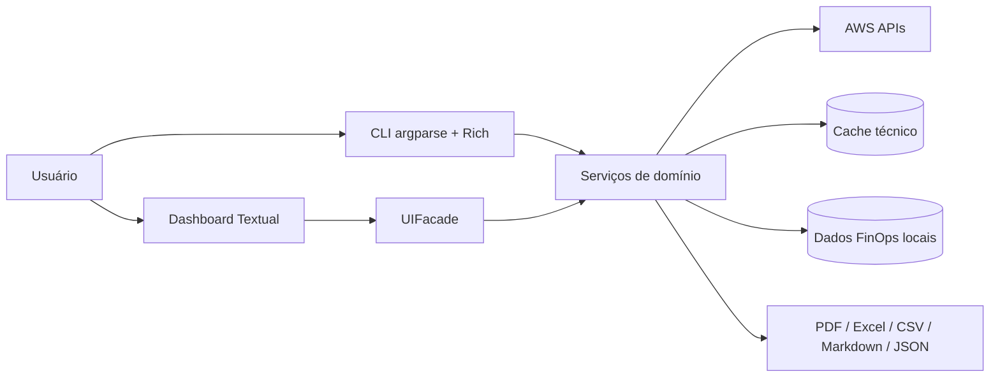
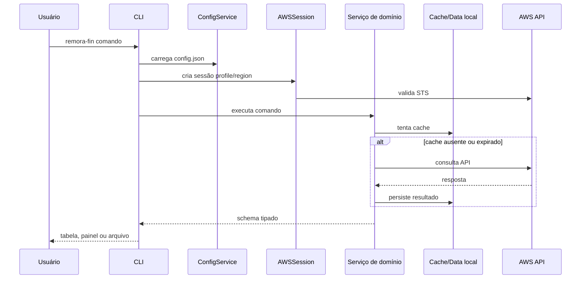
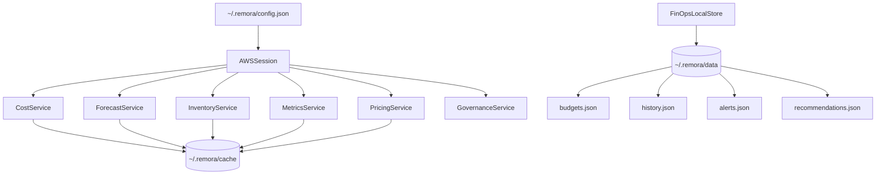

# Remora-Fin — documentação completa

O [`README.md`](../README.md) é o guia rápido. Este arquivo documenta a arquitetura, os comandos, os modelos de dados, os serviços, o dashboard, a persistência local, as permissões AWS e o desenvolvimento do Remora-Fin.

## 1. O que é o Remora-Fin

Remora-Fin é uma CLI e dashboard local-first para FinOps na AWS. A ferramenta consulta diretamente APIs AWS, transforma os resultados em modelos tipados e apresenta análises de custo, forecast, anomalias, utilização, governança e recomendações.

O sistema é somente leitura no fluxo padrão. Ele não redimensiona, exclui, etiqueta, interrompe ou altera recursos AWS.



## 2. Instalação e primeiro acesso

```bash
uv tool install remora-fin
remora-fin login
remora-fin profile
remora-fin dashboard
```

Com pip:

```bash
pip install remora-fin
```

O comando `login` seleciona um perfil boto3, uma região e opcionalmente uma role. A configuração é gravada em `~/.remora/config.json`. Todo comando, exceto `login`, exige que essa configuração exista.

### Variáveis de ambiente

| Variável | Uso | Padrão |
|---|---|---|
| `AWS_PROFILE` | Perfil AWS | `default` |
| `AWS_DEFAULT_REGION` | Região padrão | `us-east-1` |
| `AWS_ROLE_ARN` | Role opcional | vazio |
| `REMORA_CACHE_ENABLED` | Ativa/desativa cache | `true` |
| `REMORA_CACHE_TTL` | TTL em segundos | `3600` |
| `REMORA_UI_THEME` | Tema `dark` ou `light` | `dark` |
| `REMORA_DEFAULT_DAYS` | Período padrão da UI | `30` |
| `REMORA_DATA_DIR` | Diretório de dados FinOps | `~/.remora/data` |

## 3. Fluxo de execução



## 4. Referência completa dos comandos

Todos os comandos aceitam `--help`. Comandos AWS aceitam `--profile/-p` e `--region/-r` quando indicados.

### `login`

Configura e valida a sessão AWS.

```bash
remora-fin login
remora-fin login --profile production --region us-east-1
remora-fin login --profile production --region us-east-1 --role-arn arn:aws:iam::123456789012:role/FinOpsReadOnly
```

Funções: `get_available_profiles()` lista perfis boto3; `interactive_select(...)` executa a seleção numerada; `login(args)` valida STS/Cost Explorer e grava `AppSettings`; `add_login_parser(...)` registra o parser.

### `profile`

```bash
remora-fin profile
remora-fin profile --profile production --region sa-east-1
```

Mostra perfil, região, cache/UI, account ID, ARN e user ID obtidos pelo STS.

### `dashboard`

```bash
remora-fin dashboard
remora-fin dashboard --days 60 --theme light
```

Controles: `q`/`Ctrl+C` sai; `r` atualiza; o seletor troca serviço; os botões alternam relatório e action center. O indicador de alertas combina anomalias AWS e alertas FinOps locais ativos.

### `report`

```bash
remora-fin report --type breakdown --days 30 --format markdown --output costs.md
remora-fin report --type trend --days 60 --group-by SERVICE --format excel --output trend.xlsx
remora-fin report --type account --days 30 --format csv --output accounts.csv
remora-fin report --type full --days 30 --format pdf --output remora-report.pdf
```

`--type` aceita `breakdown`, `trend`, `account` e `full`; `--format` aceita `pdf`, `excel`, `csv`, `markdown` e `json`; `--days`, `--start`, `--end`, `--metric`, `--group-by`, `--service`, `--output`, `--include-charts` e `--chart-labels` controlam período, agrupamento, filtragem e composição.

### `anomalies`

```bash
remora-fin anomalies --days 30
remora-fin anomalies --days 90 --severity high
remora-fin anomalies --monitor-arn arn:aws:ce::123456789012:anomalymonitor/...
remora-fin anomalies --detail
```

Consulta anomalias do Cost Explorer, preservando score, impacto, causa-raiz, feedback e recorrência. Severidades: `low`, `medium`, `high`, `critical`.

### `forecast`

```bash
remora-fin forecast --days 90 --granularity MONTHLY
remora-fin forecast --start 2026-11-01 --end 2027-01-31 --scenarios
remora-fin forecast --group-by-type DIMENSION --group-by-key SERVICE
```

Usa forecast nativo do Cost Explorer e estratégias locais de fallback. `--scenarios` mostra cenários otimista, base e pessimista.

### `utilization`

```bash
remora-fin utilization --days 14
```

Correlaciona inventário, CloudWatch e Pricing para sinais de eficiência EC2. Os valores são heurísticos e não executam rightsizing.

### `recommendations`

```bash
remora-fin recommendations --days 14
remora-fin recommendations --service ec2 rds --severity high
remora-fin recommendations --format markdown --output backlog.md
remora-fin recommendations --format json --output recommendations.json
remora-fin recommendations --update-id <id> --state accepted --owner platform
remora-fin recommendations --update-id <id> --state rejected --note "Carga sazonal"
```

Analisa custo, governança e higiene. Estados locais: `new`, `reviewing`, `accepted`, `rejected`, `implemented`, `ignored`. O arquivo de estado é `~/.remora/data/recommendations.json`.

### `budget`

```bash
remora-fin budget set --scope total --monthly 1000
remora-fin budget set --scope service --target AmazonEC2 --monthly 400
remora-fin budget set --scope account --target 123456789012 --monthly 2000
remora-fin budget list
remora-fin budget check
```

Escopos: `total`, `service`, `account`, `region`, `tag`. Estados: `healthy`, `warning` (padrão a partir de 80%) e `exceeded`.

### `history`

```bash
remora-fin history capture --days 30
remora-fin history show --limit 12
remora-fin history export --format csv --output history.csv
remora-fin history export --format json --output history.json
```

Snapshots contêm período, perfil, conta, região, total e distribuição por serviço. São independentes do cache técnico e os últimos 365 são mantidos.

### `alerts`

```bash
remora-fin alerts check
remora-fin alerts list
remora-fin alerts list --active
remora-fin alerts acknowledge <id>
```

`alerts check` reavalia budgets e cria alertas deduplicados por fingerprint. `acknowledge` altera somente o estado local para `acknowledged`.

### `allocation`

```bash
remora-fin allocation --days 30
```

Gera showback por serviço usando grupos `SERVICE` do Cost Explorer. Exibe chave, fonte, custo, percentual e atribuição. Alocação por tags depende das dimensões de custo configuradas na AWS.

### `cache`

```bash
remora-fin cache info
remora-fin cache clear
```

`cache info` é somente leitura. `cache clear` remove `.parquet` e `.json` do diretório configurado.

## 5. Arquitetura de dados



| Caminho | Conteúdo |
|---|---|
| `~/.remora/config.json` | AWS, cache e UI. |
| `~/.remora/cache/` | Respostas temporárias AWS. |
| `~/.remora/data/budgets.json` | Metas locais. |
| `~/.remora/data/history.json` | Snapshots de custo. |
| `~/.remora/data/alerts.json` | Alertas e reconhecimentos. |
| `~/.remora/data/recommendations.json` | Estados de recomendações. |

## 6. Classes e APIs FinOps

Todos os modelos abaixo são Pydantic congelados.

### `BudgetScope`, `BudgetStatus`, `AlertStatus`, `RecommendationState`

Enums para dimensões, saúde de budgets, estado de alertas e ciclo de recomendações. Valores: `total/service/account/region/tag`; `healthy/warning/exceeded`; `active/acknowledged`; `new/reviewing/accepted/rejected/implemented/ignored`.

### `Budget`

Atributos: `id: str`, `scope: BudgetScope`, `target: str = "*"`, `monthly_limit: Decimal`, `warning_percent: Decimal = 80`, `currency: str = "USD"`, `enabled: bool = True`.

### `BudgetCheck`

Atributos: `budget`, `period`, `actual`, `forecast`, `status`. A propriedade `consumed_percent` calcula `actual / monthly_limit * 100`.

### `HistorySnapshot`

Atributos: `captured_at`, `period_start`, `period_end`, `profile`, `account_id`, `region`, `total_cost`, `by_service`, `forecast`, `anomaly_count`.

### `Alert`, `AllocationEntry`, `RecommendationRecord`

`Alert` contém `id`, `kind`, `severity`, `title`, `detail`, `created_at`, `status` e `fingerprint`. `AllocationEntry` contém `key`, `cost`, `percentage`, `assigned` e `source`. `RecommendationRecord` contém `recommendation_id`, `state`, `owner`, `note`, `first_seen` e `last_seen`.

### `FinOpsLocalStore`

Classe em `services/finops_service.py`. `__init__(directory=None)` usa o diretório explícito, `REMORA_DATA_DIR` ou `~/.remora/data`.

| Função | Retorno/comportamento |
|---|---|
| `list_budgets()` / `save_budget(budget)` | Lê ou grava budgets. |
| `list_history()` / `save_snapshot(snapshot)` | Lê ou grava snapshots; limita a 365. |
| `list_alerts(active_only=False)` / `save_alert(alert)` | Lista ou grava alertas. |
| `acknowledge_alert(alert_id)` | Altera status ou retorna `None`. |
| `list_recommendation_records()` | Retorna estados persistidos. |
| `save_recommendation_record(record)` | Substitui o mesmo ID. |
| `update_recommendation(...)` | Cria ou atualiza estado, owner e nota. |
| `check_budgets(actual_by_scope, period)` | Classifica budgets. |
| `alert_id(kind, title)` | Gera fingerprint SHA-256 de 16 caracteres. |
| `create_alert(...)` | Cria alerta se não houver ativo equivalente. |
| `allocate_by_service(groups, total)` | Calcula percentuais de showback. |

## 7. Serviços principais

| Serviço | Funções |
|---|---|
| `AWSSession` | Sessão boto3, clientes, identidade e paginação. |
| `CostService` | Totais, breakdowns, tendências e contas. |
| `ForecastService` | Forecast AWS e fallbacks locais. |
| `AnomalyService` | Anomalias e causas-raiz. |
| `InventoryService` | Inventário normalizado. |
| `MetricsService` | Estatísticas CloudWatch. |
| `PricingService` | Consultas AWS Pricing. |
| `GovernanceService` | Compliance de tags. |
| `UnitEconomicsService` | Eficiência por recurso. |
| `RecommendationService` | Recomendações read-only. |
| `DashboardService` | Agregação paralela da UI. |
| `ReportService` | Formatadores de saída. |
| `CacheService` | Cache Parquet/JSON e expiração. |

## 8. Permissões AWS

| Capacidade | Ações principais |
|---|---|
| Identidade | `sts:GetCallerIdentity` |
| Custos | `ce:GetCostAndUsage`, `ce:GetCostForecast`, `ce:GetAnomalies` |
| Governança | `tag:GetResources`, opcional `organizations:ListAccounts` |
| Métricas/preços | `cloudwatch:GetMetricStatistics`, `pricing:GetProducts` |
| Inventário | `Describe/List/Get` dos serviços analisados |
| Higiene S3 | `s3:GetLifecycleConfiguration` |

Prefira uma policy dedicada de menor privilégio em produção.

## 9. Desenvolvimento, testes e privacidade

```bash
uv sync --all-groups
uv run ruff check .
uv run ruff format --check .
uv run mypy src/remora_fin tests --ignore-missing-imports
uv run pytest tests -v
uv build
```

Os testes devem mockar AWS, injetar sessões/serviços e usar diretórios temporários. Não publique relatórios com account IDs, ARNs, nomes ou custos reais. O projeto não envia os dados locais para terceiros e não executa ações mutáveis no fluxo padrão.

## 10. Documentação complementar

- [`README.md`](../README.md): instalação e visão rápida.
- [`TECHNICAL_REFERENCE.md`](TECHNICAL_REFERENCE.md): referência módulo a módulo.
- `remora-fin <comando> --help`: opções efetivas da versão instalada.
