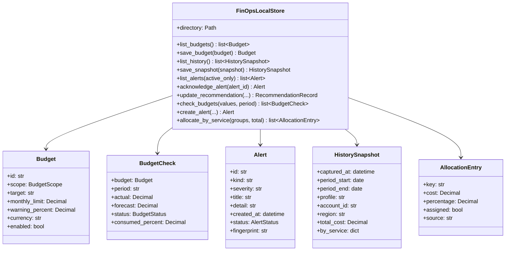
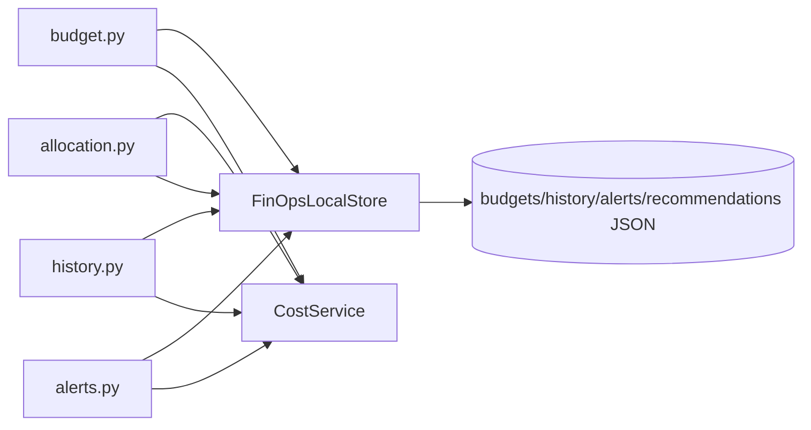
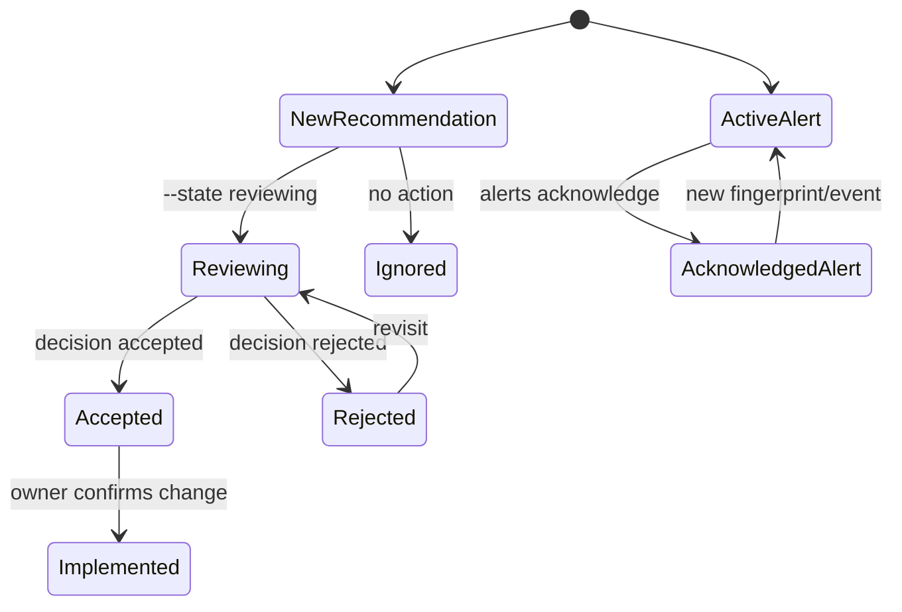

# Remora-Fin Technical Reference

This document describes every Python file in Remora-Fin, its role in the system, its principal classes and functions, and the meaning of their parameters. It reflects the source tree at version 1.0.9.

## 1. Architecture and runtime flow

Remora-Fin uses four primary layers:

```text
CLI commands __i/ Textual UI
          │
          ▼
Orchestration and domain services
          │
          ├── AWS APIs through AWSSession
          ├── Local Parquet/JSON cache
          └── Pydantic domain schemas
          │
          ▼
PDF / Excel / CSV / Markdown / JSON output
```

The console entry point is `remora_fin.cli:execute_cli`. It builds the argument parser, validates that initial configuration exists, and dispatches to a command. AWS-facing commands use `@aws_command`, which constructs and validates a shared `AWSSession` before calling the command handler.

The Textual dashboard follows a similar path: `RemoraApp` creates an `AWSSession`, `UIFacade` coordinates the domain services, and widgets render UI-ready values.

### Conventions used throughout the code

- `session: AWSSession | None`: injected AWS session. `None` selects the process-wide singleton.
- `cache: CacheService | None`: injected cache, primarily useful in tests. `None` creates a cache from application settings.
- `use_cache: bool`: permits reading and writing cached data for that operation.
- `start` / `end`: inclusive logical analysis interval represented by `datetime.date`; individual AWS APIs may treat the end date as exclusive.
- `days`: number of historical days to analyze.
- `metric`: AWS Cost Explorer metric, normally `UnblendedCost`.
- `region`: AWS region override. Cost Explorer itself is account-global, while resource inventory and CloudWatch data are regional.
- Public Pydantic models are frozen unless stated otherwise. Create modified copies with `model_copy(update=...)` rather than mutating fields.

## 2. Package entry points

### `src/remora_fin/cli.py`

Main executable module.

| Callable                              | Parameters                                | Behavior                                                                                                                                                                                                         |
| ------------------------------------- | ----------------------------------------- | ---------------------------------------------------------------------------------------------------------------------------------------------------------------------------------------------------------------- |
| `setup_logging(level=logging.INFO)` | `level`: standard-library logging level | Configures `RichHandler` and human-readable timestamps.                                                                                                                                                        |
| `execute_cli()`                     | None                                      | Creates the root parser, registers all commands, handles `--version`, verifies initial login configuration, dispatches synchronous or asynchronous handlers, and maps interrupts/errors to process exit codes. |

`ASCII_ART` is presentation-only. `execute_cli` is exposed by the package script `remora-fin` in `pyproject.toml`.

## 3. Command modules

### Shared command parameters

Most AWS commands inherit these arguments from `get_common_parser()`:

| Parameter             | Type/default | Meaning |
| --------------------- | ------------ | ------- |
| `--profile`, `-p` | str          | None    |
| `--region`, `-r`  | str          | None    |

### `src/remora_fin/commands/utils.py`

Shared command infrastructure.

| Callable                               | Parameters                                                      | Returns/behavior                                                                                                                       |
| -------------------------------------- | --------------------------------------------------------------- | -------------------------------------------------------------------------------------------------------------------------------------- |
| `validate_aws_session(session)`      | `session`: active `AWSSession`                              | Returns `True` when STS credentials validate; otherwise prints recovery guidance and returns `False`.                              |
| `parse_dates(args, default_days=30)` | `args`: parsed namespace; `default_days`: fallback lookback | Returns `(start, end)`. Explicit `end` is honored; `days` takes precedence over `start`.                                       |
| `get_common_parser()`                | None                                                            | Parent `ArgumentParser` containing profile and region options.                                                                       |
| `aws_command(func)`                  | `func`: async command handler                                 | Decorator that loads configuration, creates the session, validates credentials, and injects `session` when supported by the handler. |

### `src/remora_fin/commands/login.py`

Interactive initial setup and credential validation.

| Callable                                             | Parameters                                                                  | Behavior                                                                                       |
| ---------------------------------------------------- | --------------------------------------------------------------------------- | ---------------------------------------------------------------------------------------------- |
| `get_available_profiles()`                         | None                                                                        | Reads profile names known to boto3 and returns a list.                                         |
| `interactive_select(label, choices, default=None)` | UI label, available strings, optional default                               | Prints numbered choices and returns the selected value.                                        |
| `login(args)`                                      | `args.profile`, `args.region`, `args.role_arn` and interactive values | Selects profile/region, validates STS and Cost Explorer access, then persists `AppSettings`. |
| `add_login_parser(subparsers)`                     | Root argparse subparser collection                                          | Registers `login` and its options.                                                           |

The command is intentionally exempt from the global “already configured” check.

### `src/remora_fin/commands/profile.py`

Displays local settings and the current STS identity.

| Callable                           | Parameters                            | Behavior                                                                 |
| ---------------------------------- | ------------------------------------- | ------------------------------------------------------------------------ |
| `show_profile(args, session)`    | Common AWS args and validated session | Prints profile, region, cache/UI settings, account ID, ARN, and user ID. |
| `add_profile_parser(subparsers)` | Parser collection                     | Registers `profile`.                                                   |

### `src/remora_fin/commands/cache.py`

Local cache inspection and removal.

| Callable                         | Parameters                                   | Behavior                                                     |
| -------------------------------- | -------------------------------------------- | ------------------------------------------------------------ |
| `cache_cmd(args)`              | `args.cache_action`: `info` or `clear` | Prints cache statistics or clears cached Parquet/JSON files. |
| `add_cache_parser(subparsers)` | Parser collection                            | Registers `cache info` and `cache clear`.                |

### `src/remora_fin/commands/anomalies.py`

Cost Explorer anomaly presentation.

| Parameter              | Type/default         | Meaning                                                                      |
| ---------------------- | -------------------- | ---------------------------------------------------------------------------- |
| `--days`, `-d`     | `30`               | Historical anomaly window. AWS typically limits practical lookup to 90 days. |
| `--start`, `--end` | ISO date or `None` | Explicit date boundaries.                                                    |
| `--severity`         | low                  | medium                                                                       |
| `--monitor-arn`      | ARN or `None`      | Restricts results to one anomaly monitor.                                    |
| `--detail`           | flag                 | Requests detailed display; the current table already shows the result list.  |

`anomalies(args, session)` calls `AnomalyService.get_anomaly_summary_async`, renders a Rich table, and prints aggregate counts. `add_anomalies_parser` registers the command.

### `src/remora_fin/commands/forecast.py`

AWS cost forecasting and scenario output.

| Parameter          | Type/default             | Meaning                                               |
| ------------------ | ------------------------ | ----------------------------------------------------- |
| `--days`, `-d` | `30`                   | Number of future days.                                |
| `--granularity`  | `DAILY` or `MONTHLY` | Resolution requested from Cost Explorer.              |
| `--metric`       | Cost Explorer metric     | Amount or usage measure to forecast.                  |
| `--scenarios`    | flag                     | Adds optimistic/base/pessimistic scenario comparison. |

`forecast_cmd(args, session)` requests a native AWS forecast, prints prediction bounds, optionally calls `scenario_analysis`, and summarizes the projected total. `add_forecast_parser` defines the interface.

### `src/remora_fin/commands/utilization.py`

Resource-efficiency console view.

| Parameter          | Type/default | Meaning                                                |
| ------------------ | ------------ | ------------------------------------------------------ |
| `--days`, `-d` | `7`        | CloudWatch lookback used for utilization calculations. |

`utilization(args, session)` currently renders EC2 efficiency data from `UnitEconomicsService`, including average CPU, hourly rate, and estimated waste. `add_utilization_parser` registers the command.

### `src/remora_fin/commands/recommendations.py`

Prioritized, read-only action center.

| Parameter             | Type/default                                                                  | Meaning                                           |
| --------------------- | ----------------------------------------------------------------------------- | ------------------------------------------------- |
| `--days`, `-d`    | `14`, range 1–365                                                          | Analysis window for CloudWatch evidence.          |
| `--service`, `-s` | one or more of `ec2`, `rds`, `lambda`, `s3`, `governance`, `tags` | Limits evaluated recommendation sources.          |
| `--severity`        | `low                                                                          | medium                                            |
| `--format`, `-f`  | `table`                                                                     | Output as terminal table, JSON, or Markdown.      |
| `--output`, `-o`  | path or `None`                                                              | Writes JSON/Markdown to a file instead of stdout. |

| Callable                                   | Parameters                               | Behavior                                                                                                            |
| ------------------------------------------ | ---------------------------------------- | ------------------------------------------------------------------------------------------------------------------- |
| `_to_markdown(summary)`                  | Typed `RecommendationSummary`          | Serializes the summary and evidence into Markdown.                                                                  |
| `recommendations(args, session)`         | Parsed options and validated AWS session | Runs `RecommendationService`, applies severity filtering, renders or writes output, and reports partial failures. |
| `add_recommendations_parser(subparsers)` | Parser collection                        | Registers the command and validation choices.                                                                       |

This command never changes AWS resources.

### `src/remora_fin/commands/report.py`

Full report orchestration.

| Parameter              | Type/default               | Meaning                                                         |
| ---------------------- | -------------------------- | --------------------------------------------------------------- |
| `--type`, `-t`     | `full`                   | `breakdown`, `trend`, `account`, or composite `full`.   |
| `--format`, `-f`   | `pdf`                    | `pdf`, `excel`, `csv`, `markdown`, or `json`.         |
| `--days`, `-d`     | `30`                     | Lookback and forecast horizon.                                  |
| `--start`, `--end` | ISO date                   | Explicit report interval.                                       |
| `--metric`           | `UnblendedCost`          | Cost Explorer metric.                                           |
| `--group-by`         | optional dimension         | `SERVICE`, `LINKED_ACCOUNT`, `REGION`, or `USAGE_TYPE`. |
| `--service`, `-s`  | list or `None`           | Filters service entries and related full-report sections.       |
| `--output`, `-o`   | path or generated filename | Destination file. Defaults under `docs/`.                     |
| `--include-charts`   | enabled flag               | Includes supported report charts.                               |
| `--chart-labels`     | enabled flag               | Includes chart axis/value labels.                               |

`report(args, session)` obtains cost data and, for a full report, concurrently sourced dashboard data plus forecast, unit economics, pricing, and recommendations. It creates `ReportMetadata`, delegates serialization to `ReportService`, and prints the resulting path. `add_report_parser` registers all options.

`--group-by` is currently accepted by the parser but the command selects grouping from `--type`; it is reserved for completing arbitrary-dimension reports.

### `src/remora_fin/commands/dashboard.py`

Textual application launcher.

| Parameter          | Type/default  | Meaning                            |
| ------------------ | ------------- | ---------------------------------- |
| `--theme`        | saved setting | `dark` or `light`.             |
| `--days`, `-d` | saved setting | Default dashboard analysis window. |

`dashboard(args, session)` prints launch context and awaits `RemoraApp.run_async()`. `add_dashboard_parser` registers the command.

## 4. Schema modules

### `src/remora_fin/schemas/common.py`

| Model/type         | Fields and constraints                                                   |
| ------------------ | ------------------------------------------------------------------------ |
| `DateRange`      | `start: date`, `end: date`.                                          |
| `DateRangeInput` | Optional `start`, `end`, and `last_days` constrained to 1–3650.   |
| `Money`          | Decimal alias constrained to non-negative values and two decimal places. |
| `Percent`        | Float alias constrained to 0–100.                                       |

### `src/remora_fin/schemas/aws.py`

`AWSCallerIdentity(user_id, account, arn)` is the typed representation of `sts:GetCallerIdentity`.

### `src/remora_fin/schemas/config.py`

| Model           | Parameters/defaults                                                                                         |
| --------------- | ----------------------------------------------------------------------------------------------------------- |
| `AWSConfig`   | `profile="default"`, `region="us-east-1"`, optional `role_arn`.                                       |
| `CacheConfig` | `enabled=True`, `ttl_seconds=3600` with minimum 60, `directory=~/.remora/cache`.                      |
| `UIConfig`    | `theme="dark"`, `refresh_interval=30` with minimum 5, `default_period_days=30` constrained to 1–365. |
| `AppSettings` | Nested `aws`, `cache`, and `ui` configurations.                                                       |

`AppSettings.from_env()` reads `AWS_PROFILE`, `AWS_DEFAULT_REGION`, `AWS_ROLE_ARN`, `REMORA_CACHE_ENABLED`, `REMORA_CACHE_TTL`, `REMORA_UI_THEME`, and `REMORA_DEFAULT_DAYS` after loading `.env`.

### `src/remora_fin/schemas/cost.py`

| Model              | Important parameters                                                                                                                                                                                     |
| ------------------ | -------------------------------------------------------------------------------------------------------------------------------------------------------------------------------------------------------- |
| `CostEntry`      | Date, service, aliased `linked_account`, optional region/usage/resource dimensions, unblended/blended/amortized amounts, usage quantity, currency. Tiny negative cost corrections are clipped to zero. |
| `CostSummary`    | Total, daily average, daily extrema, top service/account, service/account counts; computes `peak_to_average_ratio`.                                                                                    |
| `CostGroup`      | Group `key`, optional label, cost, percentage 0–100, usage quantity.                                                                                                                                  |
| `CostBreakdown`  | Period, granularity, metric, entries, groups, optional summary; computes `total_cost`.                                                                                                                 |
| `CostTrendPoint` | Date, cost, and usage.                                                                                                                                                                                   |
| `CostTrend`      | Period, granularity, metric, points; computes `trend_direction` using a 5% first-half/second-half threshold.                                                                                           |

### `src/remora_fin/schemas/anomaly.py`

| Type                 | Parameters/values                                                                                                                                    |
| -------------------- | ---------------------------------------------------------------------------------------------------------------------------------------------------- |
| `AnomalySeverity`  | `low`, `medium`, `high`, `critical`; `from_percentage(pct)` maps impact percentages to severity.                                           |
| `AnomalyType`      | `spike`, `new_service`, `seasonal`, `unknown`.                                                                                               |
| `AnomalyFeedback`  | AWS values `YES`, `NO`, `PLANNED_ACTIVITY`.                                                                                                    |
| `AnomalyRootCause` | Service, optional region/account/usage fields, contribution.                                                                                         |
| `AnomalyScore`     | Maximum and current AWS anomaly scores.                                                                                                              |
| `AnomalyImpact`    | Maximum/total impact, actual/expected spend, percentage.                                                                                             |
| `Anomaly`          | Identity, monitor ARN, dates, dimension, root causes, score, impact, feedback, severity/type, recurrence flag. Computes variance and top root cause. |
| `AnomalyReport`    | Counts by severity/type, actual/expected impact totals, findings, generation time. Computes net financial impact.                                    |

### `src/remora_fin/schemas/forecast.py`

| Type                   | Parameters/behavior                                                                                                                        |
| ---------------------- | ------------------------------------------------------------------------------------------------------------------------------------------ |
| `ForecastMetric`     | Supported Cost Explorer metric names.                                                                                                      |
| `ForecastModel`      | AWS ARIMA and local strategy identifiers.                                                                                                  |
| `ForecastPoint`      | Date, predicted cost/usage, optional bounds and confidence, prediction flag.                                                               |
| `ForecastResult`     | Forecast/actual periods, metric, granularity, predictions, optional grouping, selected model, optional accuracy. Computes total and count. |
| `VarianceAnalysis`   | MAE, MAPE, RMSE, over/under-estimated periods, and bias.                                                                                   |
| `ForecastComparison` | Forecast, actual total, variance analysis; computes overall variance percentage.                                                           |

### `src/remora_fin/schemas/metrics.py`

| Model              | Parameters/behavior                                                                                                                                                            |
| ------------------ | ------------------------------------------------------------------------------------------------------------------------------------------------------------------------------ |
| `ResourceMetric` | `timestamp`, numeric `value`, and unit defaulting to `Percent`.                                                                                                          |
| `MetricSummary`  | Metric/resource identity, unit, min/max/average/total/p95, and datapoints. `data_points=None` becomes an empty list. `is_underutilized` is true for CPU averages below 5%. |

### `src/remora_fin/schemas/pricing.py`

| Model                 | Parameters/behavior                                                                                  |
| --------------------- | ---------------------------------------------------------------------------------------------------- |
| `AWSPrice`          | Rate code, description, unit, non-negative unit price, currency, optional effective date.            |
| `ProductAttributes` | Service code, optional region/location, and permitted provider-specific extra fields.                |
| `PricingDetail`     | SKU, attributes, prices; `on_demand_price` selects an On Demand item or the first available price. |

### `src/remora_fin/schemas/recommendation.py`

| Type                         | Parameters/values                                                                                                                                                             |
| ---------------------------- | ----------------------------------------------------------------------------------------------------------------------------------------------------------------------------- |
| `RecommendationCategory`   | `cost`, `governance`, `hygiene`.                                                                                                                                        |
| `RecommendationSeverity`   | `high`, `medium`, `low`.                                                                                                                                                |
| `RecommendationConfidence` | `high`, `medium`, `low`.                                                                                                                                                |
| `Recommendation`           | Stable ID, category, service, resource identity/name, title, severity, confidence, evidence list, safe suggested action, optional non-negative monthly savings, and currency. |
| `RecommendationSummary`    | Analysis days, ranked findings, estimated savings total, and independent-source failures. `total_findings` returns list length.                                             |

### `src/remora_fin/schemas/report.py`

| Model              | Parameters                                                                                                                       |
| ------------------ | -------------------------------------------------------------------------------------------------------------------------------- |
| `ReportFormat`   | `pdf`, `excel`, `csv`, `markdown`, `json`.                                                                             |
| `ReportFilters`  | Optional services/accounts/regions/tags and non-negative min/max cost.                                                           |
| `ReportConfig`   | Format, chart switches, output path, filters, currency, optional grouping.                                                       |
| `ReportMetadata` | Generation time/identity/account, required period, applied filters, version, data source.                                        |
| `FullReport`     | Optional cost breakdown/trend, anomalies, forecast, inventory summary, governance, unit economics, pricing, and recommendations. |

## 5. Service modules

### `src/remora_fin/services/aws_service.py`

AWS connection factory and retry infrastructure.

#### `AWSSession`

`AWSSession(region="us-east-1", profile="default")` is a keyed singleton: the same profile/region pair reuses the same instance. `get_instance(region, profile)` is the explicit factory.

| Method                                                                                                                                                                                                                             | Parameters                                            | Returns/behavior                                                  |
| ---------------------------------------------------------------------------------------------------------------------------------------------------------------------------------------------------------------------------------- | ----------------------------------------------------- | ----------------------------------------------------------------- |
| `_sync_client(service, **kwargs)`                                                                                                                                                                                                | boto3 service name and client options                 | Cached synchronous boto3 client.                                  |
| `cost_explorer()`, `organizations()`, `pricing()`, `s3()`, `sts()`                                                                                                                                                       | None                                                  | Typed service clients.                                            |
| `ec2()`, `rds()`, `lambda_client()`, `dynamodb()`, `cloudfront()`, `elasticache()`, `redshift()`, `sns()`, `sqs()`, `emr()`, `sagemaker()`, `cloudwatch()`, `kms()`, `secretsmanager()`, `tagging()` | None                                                  | Cached boto3 clients for inventory/metrics/governance operations. |
| `async_session()`                                                                                                                                                                                                                | None                                                  | Underlying aioboto3 session.                                      |
| `async_client(service, **kwargs)`                                                                                                                                                                                                | service name and options                              | Async client context manager.                                     |
| `validate_credentials()`                                                                                                                                                                                                         | None                                                  | Calls STS and returns a boolean.                                  |
| `check_billing_access()`                                                                                                                                                                                                         | None                                                  | Probes Cost Explorer access.                                      |
| `get_caller_identity()`                                                                                                                                                                                                          | None                                                  | Normalized `account`, `arn`, and `user_id` dictionary.      |
| `fetch_token_paginated(client, method_name, result_key, **kwargs)`                                                                                                                                                               | Client, API method, response collection key, API args | Collects all `NextToken` pages synchronously.                   |
| `fetch_token_paginated_async(...)`                                                                                                                                                                                               | Same logical inputs                                   | Async equivalent.                                                 |

`retry_with_backoff(max_retries=3, base_delay=1.0)` and `async_retry_with_backoff(...)` are decorators. They retry transient throttling/service errors with exponential delay; `func` is supplied when the decorator is applied.

### `src/remora_fin/services/base_service.py`

Shared base for AWS domain services.

| Member                                                                            | Parameters                                     | Behavior                                                                                                                             |
| --------------------------------------------------------------------------------- | ---------------------------------------------- | ------------------------------------------------------------------------------------------------------------------------------------ |
| `BaseService(service_name, session=None, cache=None)`                           | Logical service name and optional dependencies | Resolves session and configured cache.                                                                                               |
| `session`, `cache`                                                            | Properties                                     | Expose resolved dependencies.                                                                                                        |
| `cache_query(query)`                                                            | Raw query dictionary                           | Adds account, profile, and region scope to prevent cross-account cache leakage.                                                      |
| `get_cached_or_fetch_async(query, fetch_func, use_cache=True, max_age_hours=1)` | Cache key, awaitable factory, switch, TTL      | Returns cached JSON or awaits the source; serializes Pydantic results before caching. Returns `None` after a logged fetch failure. |

### `src/remora_fin/services/cache_service.py`

Local Parquet and JSON persistence.

| Method                                                           | Parameters                                     | Behavior                                             |
| ---------------------------------------------------------------- | ---------------------------------------------- | ---------------------------------------------------- |
| `CacheService(cache_dir=None, enabled=True, ttl_seconds=3600)` | Storage directory, feature switch, default TTL | Initializes the cache directory when enabled.        |
| `_generate_key(query)`                                         | Serializable dictionary                        | Stable hash used as the filename.                    |
| `_is_expired(cache_file, max_age_hours)`                       | Path and optional call-specific TTL            | Compares file age with override or configured TTL.   |
| `get(query, max_age_hours=None)`                               | Query and TTL override                         | Returns a Polars DataFrame from Parquet or `None`. |
| `set(query, df)`                                               | Query and DataFrame                            | Writes Parquet atomically when enabled.              |
| `get_json(query, max_age_hours=None)`                          | Query and TTL override                         | Returns a dictionary/list or `None`.               |
| `set_json(query, data)`                                        | Query and JSON-compatible data                 | Writes JSON atomically when enabled.                 |
| `clear()`                                                      | None                                           | Removes all cache files.                             |
| `get_stats()`                                                  | None                                           | Returns count, byte size, and directory metadata.    |
| `cleanup(max_age_days=7)`                                      | Maximum file age                               | Deletes old cache entries.                           |

### `src/remora_fin/services/config_service.py`

Configuration singleton and builder.

| API                                                                      | Parameters      | Behavior                                                                           |
| ------------------------------------------------------------------------ | --------------- | ---------------------------------------------------------------------------------- |
| `ConfigService()`                                                      | None            | Loads `~/.remora/config.json`, environment values, or defaults once per process. |
| `settings`                                                             | Property        | Current immutable `AppSettings`.                                                 |
| `get_aws_profile()`, `get_default_region()`, `get_output_format()` | None            | Convenience configuration accessors.                                               |
| `save_config(settings)`                                                | `AppSettings` | Persists formatted JSON and updates in-memory settings.                            |
| `is_configured()`                                                      | None            | Reports whether setup has produced a usable configuration file.                    |
| `ConfigBuilder()`                                                      | None            | Starts with default nested configuration.                                          |
| `with_aws_profile(profile)`                                            | Profile name    | Sets profile and returns the builder.                                              |
| `with_region(region)`                                                  | AWS region      | Sets region and returns the builder.                                               |
| `with_role_arn(role_arn)`                                              | Optional ARN    | Sets role assumption metadata.                                                     |
| `with_cache_enabled(enabled)`                                          | Boolean         | Enables/disables local caching.                                                    |
| `with_cache_ttl(ttl)`                                                  | Seconds         | Sets cache lifetime.                                                               |
| `with_theme(theme)`                                                    | Theme name      | Sets UI theme.                                                                     |
| `build()`                                                              | None            | Returns validated `AppSettings`.                                                 |

### `src/remora_fin/services/cost_service.py`

Cost Explorer query construction, pagination, parsing, and aggregation.

#### `CostQueryBuilder`

| Method                                             | Parameters                            | Meaning                                                           |
| -------------------------------------------------- | ------------------------------------- | ----------------------------------------------------------------- |
| `with_time_period(start, end)`                   | Dates                                 | Sets Cost Explorer time period.                                   |
| `with_granularity(granularity)`                  | `DAILY`, `MONTHLY`, etc.          | Sets response resolution.                                         |
| `with_metric(metric)`                            | AWS metric name                       | Sets requested amount/usage measure.                              |
| `with_filter(key, value, match_option="EQUALS")` | Dimension/tag key, value, match rule  | Adds a Cost Explorer filter.                                      |
| `with_group_by(group_type, key)`                 | Usually `DIMENSION`/`TAG` and key | Adds grouping.                                                    |
| `build()`                                        | None                                  | Validates required fields and returns the AWS request dictionary. |

#### `CostService`

| Method                                                                          | Parameters                        | Returns                               |
| ------------------------------------------------------------------------------- | --------------------------------- | ------------------------------------- |
| `normalize_service_name(name)`                                                | AWS display name                  | Stable normalized service label.      |
| `get_total_cost_async(start, end, region=None)`                               | Period and optional region filter | `CostSummary`.                      |
| `get_daily_trend_async(start, end, metric="UnblendedCost", region=None)`      | Period, metric, region            | `CostTrend`.                        |
| `get_cost_by_service_async(start, end, metric="UnblendedCost", region=None)`  | Period and filters                | `CostBreakdown` grouped by service. |
| `get_cost_by_account_async(start, end, metric="UnblendedCost")`               | Period and metric                 | Account-grouped `CostBreakdown`.    |
| `get_daily_trend(...)`, `get_total_cost(...)`, `get_cost_by_service(...)` | Equivalent core inputs            | Synchronous interfaces.               |

Private helpers fetch every Cost Explorer page, parse rows to Polars, safely convert Decimals, compute percentages, and build summaries. Cache keys include the fully built query and AWS identity.

### `src/remora_fin/services/anomaly_service.py`

AWS-native cost anomaly repository with local classification.

| Method                                                                                   | Parameters                    | Returns/behavior                                                                                  |
| ---------------------------------------------------------------------------------------- | ----------------------------- | ------------------------------------------------------------------------------------------------- |
| `AnomalyService(session=None, cache=None)`                                             | Dependencies                  | Initializes the service.                                                                          |
| `fetch_anomalies(start, end, monitor_arn=None)`                                        | Period and optional monitor   | Parsed `Anomaly` list.                                                                          |
| `get_anomaly_summary(start, end, monitor_arn=None, use_cache=True)`                    | Period, monitor, cache switch | Aggregated `AnomalyReport`.                                                                     |
| `get_anomaly_summary_async(...)`                                                       | Same parameters               | Async equivalent.                                                                                 |
| `get_anomaly_details(anomaly_id)`                                                      | AWS anomaly ID                | Finding from the last 90 days or `None`.                                                        |
| `get_root_cause_analysis(anomaly_id)`                                                  | AWS anomaly ID                | Root-cause list.                                                                                  |
| `create_monitor(name, monitor_type="DIMENSIONAL", dimension="SERVICE", metadata=None)` | Monitor definition            | New monitor ARN. This is a mutating AWS API and is not used by the read-only recommendation flow. |
| `list_monitors()`                                                                      | None                          | Raw monitor dictionaries.                                                                         |
| `delete_monitor(monitor_arn)`                                                          | Monitor ARN                   | Deletes a Cost Explorer monitor.                                                                  |

Internal pagination accepts optional feedback and minimum-impact filters, converts AWS results to schemas, and derives local type/severity summaries.

### `src/remora_fin/services/forecast_service.py`

Strategy-based forecasting.

| Class/method                                                                                                            | Parameters                                                  | Behavior                                                      |
| ----------------------------------------------------------------------------------------------------------------------- | ----------------------------------------------------------- | ------------------------------------------------------------- |
| `ForecastStrategy.predict(historical_data, start, end, metric, **kwargs)`                                             | Polars history, forecast interval, metric, strategy options | Abstract strategy contract.                                   |
| `AWSCostExplorerNativeForecast(session=None).predict(...)`                                                            | Adds granularity and optional grouping through `kwargs`   | Calls native Cost Explorer forecast APIs.                     |
| `MovingAverageForecast(window=7).predict(...)`                                                                        | Rolling window and required history                         | Generates one point per day from the trailing moving average. |
| `ForecastService(session=None, cost_service=None, cache=None)`                                                        | Dependencies                                                | Main facade.                                                  |
| `get_aws_native_forecast_async(start, end, metric=UNBLENDED_COST, granularity="DAILY", use_cache=True)`               | Forecast request                                            | Cached async `ForecastResult`.                              |
| `get_aws_native_forecast(start, end, metric, granularity, group_by_type=None, group_by_key=None, historical_days=90)` | Request plus historical context                             | Synchronous native strategy result.                           |
| `get_forecast(start, end, metric, granularity, **kwargs)`                                                             | Generic request                                             | Uses AWS first, moving-average fallback on failure.           |
| `get_forecast_with_confidence(start, end, metric, confidence_level=0.95)`                                             | Forecast request and confidence                             | Adds bounds based on historical standard deviation.           |
| `compare_actual_vs_predicted(forecast, actual_start, actual_end)`                                                     | Forecast and actual interval                                | `ForecastComparison` with error metrics.                    |
| `scenario_analysis(forecast, variations)`                                                                             | Named fractional changes, e.g. `{"growth": 0.1}`          | New forecast per scenario.                                    |

### `src/remora_fin/services/inventory_service.py`

Registry-driven async AWS inventory.

`ResourceConfig(client_name, paginator_name, list_method=None, result_path=None, mapper=None)` defines how to call and normalize a resource API. `RESOURCE_REGISTRY` covers EC2, S3, RDS, Lambda, DynamoDB, CloudFront, ElastiCache, EMR, Redshift, SageMaker notebooks, KMS, Secrets Manager, SNS, SQS, ECS, EKS, and VPC.

| Method                                                  | Parameters                           | Returns                                                               |
| ------------------------------------------------------- | ------------------------------------ | --------------------------------------------------------------------- |
| `InventoryService(session=None, cache=None)`          | Dependencies                         | Initialized service.                                                  |
| `list_resources_async(resource_type, use_cache=True)` | Registry key and cache switch        | Normalized resource dictionaries; unknown types return an empty list. |
| `_resolve_path(data, path)`                           | AWS response and nested key sequence | Extracted list; specially flattens EC2 reservations.                  |

### `src/remora_fin/services/metrics_service.py`

CloudWatch metric adapter.

| Method                                                                                                            | Parameters                                                        | Returns                                                                                                              |
| ----------------------------------------------------------------------------------------------------------------- | ----------------------------------------------------------------- | -------------------------------------------------------------------------------------------------------------------- |
| `get_metric_statistics(namespace, metric_name, dimensions, start_time, end_time, period=3600, statistics=None)` | CloudWatch request; statistics default to Average/Minimum/Maximum | Cached `MetricSummary` or `None`. The first requested statistic determines each point; `total` preserves sums. |
| `get_ec2_cpu_utilization(instance_id, days=7)`                                                                  | Instance ID and lookback                                          | EC2 CPU summary.                                                                                                     |
| `get_rds_cpu_utilization(db_instance_id, days=7)`                                                               | DB identifier and lookback                                        | RDS CPU summary.                                                                                                     |
| `get_rds_connections(db_instance_id, days=7)`                                                                   | DB identifier and lookback                                        | Average database connections.                                                                                        |
| `get_lambda_errors(function_name, days=7)`                                                                      | Function and lookback                                             | Summed Lambda errors.                                                                                                |
| `get_lambda_invocations(function_name, days=7)`                                                                 | Function and lookback                                             | Summed invocations.                                                                                                  |
| `get_lambda_duration(function_name, days=7)`                                                                    | Function and lookback                                             | Average duration.                                                                                                    |

### `src/remora_fin/services/pricing_service.py`

AWS public Pricing API adapter.

| Method                                                                  | Parameters                                       | Returns                                        |
| ----------------------------------------------------------------------- | ------------------------------------------------ | ---------------------------------------------- |
| `get_products(service_code, filters)`                                 | Pricing service code and AWS filter dictionaries | Parsed `PricingDetail` list, cached as JSON. |
| `_parse_item(item)`                                                   | Decoded AWS price document                       | One `PricingDetail`.                         |
| `get_ec2_price(instance_type, region_code, operating_system="Linux")` | Instance type, region, OS                        | Matching EC2 price or `None`.                |
| `get_s3_price(volume_type, region_code)`                              | Storage class/type and region                    | Matching storage price or `None`.            |
| `get_rds_price(instance_class, region_code, database_engine)`         | RDS class, region, engine                        | Matching price or `None`.                    |
| `get_lambda_price(region_code)`                                       | Region                                           | Duration/request price mapping.                |
| `get_region_pricing_summary(region_code)`                             | Region                                           | Compact service/rate dictionary for reports.   |

### `src/remora_fin/services/governance_service.py`

Required-tag compliance.

| Method                                                      | Parameters                         | Returns                                                           |
| ----------------------------------------------------------- | ---------------------------------- | ----------------------------------------------------------------- |
| `GovernanceService(session=None, cache=None)`             | Dependencies                       | Initialized service.                                              |
| `get_tag_compliance(required_tags, use_cache=True)`       | Required tag keys and cache switch | Score, counts, and per-resource details.                          |
| `get_tag_compliance_async(required_tags, use_cache=True)` | Same                               | Async equivalent using the Resource Groups Tagging API paginator. |

A resource is compliant only when every required key exists. An empty resource set scores 100%.

### `src/remora_fin/services/unit_economics_service.py`

Combines inventory, CloudWatch, and public pricing.

| Method                                                                             | Parameters              | Returns/logic                                                          |
| ---------------------------------------------------------------------------------- | ----------------------- | ---------------------------------------------------------------------- |
| `UnitEconomicsService(session=None, inventory=None, pricing=None, metrics=None)` | Injectable dependencies | Initializes correlation service.                                       |
| `get_ec2_efficiency(days=7)`                                                     | Lookback                | Instances sorted by estimated avoidable spend; combines price and CPU. |
| `get_s3_efficiency()`                                                            | None                    | Bucket creation metadata and current standard storage rate.            |
| `get_rds_efficiency(days=7)`                                                     | Lookback                | RDS CPU, price, and estimated waste.                                   |
| `get_lambda_efficiency(days=7)`                                                  | Lookback                | Duration/errors, memory, and estimated invocation cost.                |

These are heuristic indicators, not automatic remediation decisions.

### `src/remora_fin/services/recommendation_service.py`

Read-only ranked recommendation engine.

| Method                                                                                               | Parameters                                               | Behavior                                                                                                                                           |
| ---------------------------------------------------------------------------------------------------- | -------------------------------------------------------- | -------------------------------------------------------------------------------------------------------------------------------------------------- |
| `RecommendationService(session=None, inventory=None, pricing=None, metrics=None, governance=None)` | Injectable data sources                                  | Creates the engine.                                                                                                                                |
| `get_recommendations(days=14, services=None, required_tags=None)`                                  | Lookback, optional source filter, optional required tags | Runs selected sources concurrently, isolates failures, ranks findings by savings/severity/service/resource, and returns `RecommendationSummary`. |
| `_id(category, service, resource_id, rule)`                                                        | Stable identifying strings                               | First 16 characters of a SHA-256 digest.                                                                                                           |
| `_severity(savings)`                                                                               | Optional monthly estimate                                | High at $100+, medium at $25+, low below $25; non-monetary findings default medium.                                                                |

Rules:

- EC2: running instance, at least three datapoints, average CPU below 10%, and p95 below 20%.
- RDS: available instance meeting EC2-style CPU thresholds plus average connections below 1.
- Lambda: at least one CloudWatch datapoint and zero total invocations.
- S3: bucket at least 90 days old and no lifecycle rules. Permission failures are skipped rather than misreported.
- Governance: one finding per resource missing any required tag.

Estimated EC2/RDS savings use `hourly price × 730 × 50%`. They are deliberately absent when pricing is unavailable.

#### Recommendation cost and billing semantics

There are two different meanings of “cost” in this feature:

1. **Estimated savings shown in a finding.** This is not a charge and not a forecast of the AWS bill. For EC2/RDS it is a conservative review estimate: current on-demand hourly price × 730 hours × 50%. It assumes that a validated rightsizing/retirement decision could avoid roughly half of the current on-demand rate. Lambda, S3 hygiene, and tag findings intentionally have no dollar estimate because this implementation does not have enough evidence to price those actions reliably.
2. **AWS API usage generated by the scan.** The command is read-only, but it does make AWS API calls. A scan may call inventory APIs, CloudWatch `GetMetricStatistics`, Pricing API, Resource Groups Tagging API, and S3 `GetLifecycleConfiguration`. Pagination can increase call counts when an account has many resources.

The recommendation command itself does not call Cost Explorer. The dashboard and `report --type full` do call Cost Explorer for their cost sections. AWS currently documents Cost Explorer API requests at **$0.01 per request** for the primary billing view; paginated requests count as requests. CloudWatch documents `GetMetricStatistics` as included up to one million API requests in the AWS Free Tier, with additional API request charges depending on the account and service pricing. See the [Cost Explorer pricing page](https://aws.amazon.com/aws-cost-management/aws-cost-explorer/pricing/) and [CloudWatch cost guidance](https://docs.aws.amazon.com/AmazonCloudWatch/latest/monitoring/cloudwatch_billing.html) for current terms.

The project reduces repeated calls through persistent cache files and a five-minute in-memory dashboard cache. A practical operating pattern is to run recommendations on demand or on a low-frequency schedule, keep caching enabled, narrow `--service` when investigating one area, and avoid treating every dashboard refresh as a free operation.

### `src/remora_fin/services/dashboard_service.py`

Parallel dashboard aggregation.

| Method                                                                                                                                   | Parameters                        | Returns                                                                                                               |
| ---------------------------------------------------------------------------------------------------------------------------------------- | --------------------------------- | --------------------------------------------------------------------------------------------------------------------- |
| `DashboardService(session=None, cache=None, cost_service=None, anomaly_service=None, inventory_service=None, governance_service=None)` | Injectable dependencies           | Orchestrator.                                                                                                         |
| `get_summary_parallel(days=30, use_cache=True, required_tags=None, region=None)`                                                       | Lookback, cache, tag list, region | Dictionary containing cost summary/trend/breakdown, anomalies, governance, inventory counts/details, and update date. |

Individual task failures are logged and replaced with safe defaults, allowing partial dashboards.

### `src/remora_fin/services/report_service.py`

Strategy-based multi-format reporting.

| Class/API                                                           | Parameters                                                        | Behavior                                                                                                                                                                                                                                                                                                                                        |
| ------------------------------------------------------------------- | ----------------------------------------------------------------- | ----------------------------------------------------------------------------------------------------------------------------------------------------------------------------------------------------------------------------------------------------------------------------------------------------------------------------------------------- |
| `S3Exporter(session=None)`                                        | AWS session                                                       | Creates an optional report uploader.                                                                                                                                                                                                                                                                                                            |
| `S3Exporter.upload(content, bucket, key)`                         | Bytes/string, bucket, object key                                  | Calls `PutObject` and returns `s3://bucket/key`.                                                                                                                                                                                                                                                                                            |
| `ReportFormatter`                                                 | Abstract base                                                     | Defines `format_cost`, `format_anomalies`, `format_forecast`, `format_infrastructure`, `format_governance`, `format_unit_economics`, `format_pricing`, `format_recommendations`, and `format_full`. Each receives typed `data`, optional `metadata`, optional `config`, and optionally an existing PDF for composition. |
| `PDFFormatter`                                                    | No constructor arguments                                          | Creates paginated reports and charts with fpdf2. Private chart helpers accept a PDF, typed data points/groups, titles, and label switches.                                                                                                                                                                                                      |
| `ExcelFormatter`                                                  | No constructor arguments                                          | Converts sections to Polars and writes one or more xlsxwriter worksheets.                                                                                                                                                                                                                                                                       |
| `FastTableFormatter(format="csv")`                                | Serialization format marker                                       | Produces CSV for supported tabular sections. Composite full CSV currently returns an explanatory message.                                                                                                                                                                                                                                       |
| `MarkdownFormatter`                                               | No constructor arguments                                          | Produces documentation-ready section tables.                                                                                                                                                                                                                                                                                                    |
| `JSONFormatter`                                                   | No constructor arguments                                          | Uses Pydantic JSON serialization when available and `json.dumps(default=str)` otherwise.                                                                                                                                                                                                                                                      |
| `ReportService.generate_report(data, config=None, metadata=None)` | Supported schema/dictionary, output configuration, report context | Chooses a formatter by `config.format`, dispatches by data type, optionally writes `config.output_path`, and returns string or bytes.                                                                                                                                                                                                       |

## 6. UI modules

### `src/remora_fin/ui/app.py`

| Class/method                                                                        | Parameters             | Behavior                                                                                             |
| ----------------------------------------------------------------------------------- | ---------------------- | ---------------------------------------------------------------------------------------------------- |
| `RemoraApp(region="us-east-1", profile="default", default_days=30, theme="dark")` | AWS/UI defaults        | Loads theme CSS before Textual startup and stores launch context.                                    |
| `on_mount()`                                                                      | Textual event          | Creates session/facade and pushes `DashboardScreen`.                                               |
| `action_refresh()`                                                                | Bound to `r`         | Starts a screen refresh and shows notification.                                                      |
| `DashboardScreen(facade, days=30)`                                                | UI facade and lookback | Main full-width dashboard screen.                                                                    |
| `compose()`                                                                       | None                   | Creates status bar, heading, dashboard widget, and footer.                                           |
| `_load_services()`                                                                | Worker                 | Populates the service selector.                                                                      |
| `_refresh_data()`                                                                 | Exclusive worker       | Fetches UI data, updates KPIs/chart/tables/status, and converts exceptions into visible error state. |
| `on_button_pressed(event)`                                                        | Textual button event   | Switches report/action-center views.                                                                 |
| `on_select_changed(event)`                                                        | Textual select event   | Updates service filter and refreshes.                                                                |

Bindings: `q` and `Ctrl+C` quit; `r` refreshes.

### `src/remora_fin/ui/facade.py`

`DashboardUIData` is the immutable UI transfer object: formatted costs, anomaly/inventory values, context labels, chart/table rows, recommendation count, savings text, and action rows.

| Method                                                                     | Parameters                       | Returns                                                                                                      |
| -------------------------------------------------------------------------- | -------------------------------- | ------------------------------------------------------------------------------------------------------------ |
| `UIFacade(session)`                                                      | AWS session or `None`          | Creates dashboard/cost/anomaly/forecast/inventory/recommendation services and a five-minute in-memory cache. |
| `_get_from_cache(key)` / `_set_to_cache(key, value, ttl=None)`         | Cache key/value/optional seconds | UI-local cache operations.                                                                                   |
| `get_available_services(days, region=None)`                              | Lookback and region              | Union of billed services and inventory-supported services.                                                   |
| `get_dashboard_data(days, region=None, selected_service="All Services")` | View context                     | Cached `DashboardUIData`.                                                                                  |
| `_get_all_services_dashboard(days, region=None)`                         | Aggregate context                | Global cost, anomaly, inventory, top-cost, and recommendation view.                                          |
| `_get_single_service_dashboard(service, days, region=None)`              | Service context                  | Filtered cost/inventory view; recommendation fields currently default empty.                                 |
| `get_cost_data(days)`                                                    | Lookback                         | Date/value chart tuples.                                                                                     |
| `get_anomaly_report(days)`                                               | Lookback capped at 90            | Anomaly report.                                                                                              |
| `get_forecast_result(days)`                                              | Future horizon                   | AWS native forecast.                                                                                         |

### `src/remora_fin/ui/styles/theme.py`

Loads the dark tactical CSS from `tactical.tcss`, defines light-theme overrides, and exposes `THEMES`.

`get_theme_css(name="dark")` returns the requested CSS string and safely falls back to dark for unknown names.

### `src/remora_fin/ui/widgets/common/widgets.py`

| Widget                                                         | Parameters/behavior                                                                   |
| -------------------------------------------------------------- | ------------------------------------------------------------------------------------- |
| `ErrorBanner.show(message)`                                  | Adds error styling, writes a system-error message, and displays the banner.           |
| `ErrorBanner.hide()`                                         | Hides the banner.                                                                     |
| `KPICard(label, value, variant="normal", id=None, index="")` | Creates a labeled dashboard card. `variant` controls normal/warning/danger styling. |
| `KPICard.update_value(value, variant=None)`                  | Replaces the value and optionally its visual variant.                                 |

### `src/remora_fin/ui/widgets/cost_chart.py`

Text-based bar chart.

| Method                                                         | Parameters                            | Behavior                                                |
| -------------------------------------------------------------- | ------------------------------------- | ------------------------------------------------------- |
| `CostChartWidget(title="Cost Trend", id=None, classes=None)` | Display title and Textual identifiers | Initializes empty series.                               |
| `update_data(dates, values)`                                 | Parallel label/value lists            | Replaces series and renders.                            |
| `_render_chart()`                                            | None                                  | Shows the last 12 points with width-aware colored bars. |
| `show_daily_trend(trend_data)`                               | `(date, cost)` tuples               | Adapts trend data.                                      |
| `show_service_breakdown(services)`                           | `(service, cost)` tuples            | Adapts service totals.                                  |

### `src/remora_fin/ui/widgets/dashboard.py`

| Method                                                                                                                                                   | Parameters                                     | Behavior                                                                                      |
| -------------------------------------------------------------------------------------------------------------------------------------------------------- | ---------------------------------------------- | --------------------------------------------------------------------------------------------- |
| `DashboardWidget(total_cost="$0.00", daily_avg="$0.00", anomaly_count=0, forecast_trend="—", default_days=30, estimated_savings="$0.00/mo", id=None)` | Initial KPI/view values                        | Builds selector, controls, five KPI cards, chart, cost table, action table, and activity log. |
| `log_event(level, message)`                                                                                                                            | `INFO`, `OKAY`, `WARN`, `ERR` and text | Appends timestamped colored activity.                                                         |
| `update_kpis(total_cost=None, daily_avg=None, anomaly_count=None, inventory=None, estimated_savings=None)`                                             | Optional formatted replacements                | Updates only provided cards.                                                                  |
| `update_status_header(service_name, context)`                                                                                                          | Selected service and description               | Rewrites resource-monitor context.                                                            |
| `toggle_view()`                                                                                                                                        | None                                           | Switches between chart and cost-report table.                                                 |
| `show_recommendations()`                                                                                                                               | None                                           | Opens the action-center table.                                                                |
| `update_report_table(data)`                                                                                                                            | Three-column row tuples                        | Replaces cost table rows.                                                                     |
| `update_recommendations(data)`                                                                                                                         | Four-column row tuples                         | Replaces action-center rows.                                                                  |

### `src/remora_fin/ui/widgets/anomaly_panel.py`

| Widget/method                          | Parameters                     | Behavior                                                                    |
| -------------------------------------- | ------------------------------ | --------------------------------------------------------------------------- |
| `SeverityBadge(severity)`            | Severity value                 | Color-coded label.                                                          |
| `AnomalyDetailCard(anomaly)`         | Typed `Anomaly`              | Shows identity, service, timeline, spend, variance, and root causes.        |
| `AnomalyPanel(report=None, id=None)` | Optional report and Textual ID | Scrollable anomaly summary/table.                                           |
| `update_report(report)`              | `AnomalyReport`              | Replaces the report, removes existing child widgets, and redraws the panel. |
| `filter_by_severity(severity)`       | Severity string                | Returns matching anomaly objects; it does not mutate the displayed table.   |

### `src/remora_fin/ui/widgets/forecast_panel.py`

| Widget/method                                      | Parameters                    | Behavior                                            |
| -------------------------------------------------- | ----------------------------- | --------------------------------------------------- |
| `AccuracyMeter(accuracy=None, label="ACCURACY")` | Fractional accuracy and label | Renders a bounded 0–100% bar or unavailable state. |
| `ForecastPanel(result=None, id=None)`            | Optional `ForecastResult`   | Shows summary and prediction table.                 |
| `update_forecast(result)`                        | Forecast result               | Replaces current data and redraws.                  |
| `toggle_confidence_interval()`                   | None                          | Toggles display of lower/upper bounds.              |

## 7. Test modules

Tests use pytest, pytest-asyncio, mocks, and temporary directories. AWS network calls are replaced by injected sessions/clients.

| File                                      | What it verifies                                                                                                              | Important fixture parameters                                                                                                              |
| ----------------------------------------- | ----------------------------------------------------------------------------------------------------------------------------- | ----------------------------------------------------------------------------------------------------------------------------------------- |
| `tests/test_cache_service.py`           | Stable keys, Parquet/JSON round trips, expiration, configured TTL, disabled writes, account-scoped keys.                      | `tmp_path` isolates filesystem state; `_SessionStub` supplies identity/profile/region.                                                |
| `tests/test_cost_service.py`            | Cache reuse and total-cost aggregation.                                                                                       | `mock_aws_session_class` supplies Cost Explorer responses.                                                                              |
| `tests/test_governance_service.py`      | Required-tag scoring and detail generation.                                                                                   | Mock session/tagging paginator.                                                                                                           |
| `tests/test_inventory_service.py`       | EC2, RDS, Lambda, S3, VPC normalization and unknown resource handling.                                                        | `mock_session` tuple provides async client/paginator behavior.                                                                          |
| `tests/test_metrics_service.py`         | Correct parsing of CloudWatch `Sum`, including `average`, `total`, and datapoints.                                      | Mock CloudWatch and cache.                                                                                                                |
| `tests/test_pricing_service.py`         | Price-document parsing, caching, API calls, and EC2/Lambda/S3/RDS lookups.                                                    | `mock_session`, `pricing_service`, patched JSON decoder.                                                                              |
| `tests/test_profile_command.py`         | Profile display, credential failure handling, and parser registration.                                                        | Parsed `argparse.Namespace`, mock session/config/console.                                                                               |
| `tests/test_recommendation_service.py`  | Cross-source ranking, conservative savings, Lambda/S3/tag findings, partial failure isolation, insufficient metric rejection. | Injectable inventory, metrics, pricing, governance, and session mocks. `_metric(name, average, p95, total=None)` builds test summaries. |
| `tests/test_report_service.py`          | Markdown, CSV, PDF, pricing sections, invalid formats, and recommendation output in Markdown/JSON/PDF/Excel.                  | `report_service`, `mock_cost_breakdown`, `report_metadata`.                                                                         |
| `tests/test_s3_exporter.py`             | Correct S3 `put_object` call and returned URI.                                                                              | Mock session/client.                                                                                                                      |
| `tests/test_ui_theme.py`                | Theme selection, dashboard toggle, live status, and Textual smoke behavior.                                                   | `monkeypatch` replaces AWS/facade dependencies.                                                                                         |
| `tests/test_unit_economics.py`          | Basic cost-per-unit calculation example and service construction.                                                             | Local Polars data and `MagicMock`.                                                                                                      |
| `tests/test_unit_economics_aws_deep.py` | EC2 efficiency correlation across inventory, pricing, and metrics.                                                            | `mock_session`, `mock_inventory`, `mock_pricing`, `mock_metrics`; async test receives fixtures by name.                           |

## 8. Extension guidance

When adding a new AWS service:

1. Add its normalized inventory mapping to `RESOURCE_REGISTRY`.
2. Add required CloudWatch helpers to `MetricsService` and pricing helpers to `PricingService` only when the signal is defensible.
3. Add immutable schemas for any reusable result type.
4. Add a recommendation rule as an independent coroutine so permission failures remain isolated.
5. Export the new public type/service through the relevant `__init__.py`.
6. Add CLI/UI/report presentation only after the service API is tested.
7. Mock every AWS call and test missing permissions, missing datapoints, missing prices, pagination, and cache behavior.

## 9. Safety and data handling

- Cost data, account IDs, ARNs, and generated reports may be sensitive and should not be committed.
- The recommendation engine is advisory and read-only. Estimates must be validated against workload peaks, commitments, and business requirements.
- `AnomalyService.create_monitor` and `delete_monitor` are mutating APIs; they are service capabilities, not part of the default CLI recommendation workflow.
- Cache keys are scoped by account, profile, and region, but cache files remain local plaintext/Parquet under the configured directory.

## 10. FinOps planning modules

The current release adds a local FinOps data plane for budgets, history, alerts, allocation, and recommendation lifecycle state. It is intentionally separate from the technical AWS-response cache.



### `src/remora_fin/schemas/finops.py`

| Type                     | Attributes / behavior                                                                                                                                                         |
| ------------------------ | ----------------------------------------------------------------------------------------------------------------------------------------------------------------------------- |
| `BudgetScope`          | `total`, `service`, `account`, `region`, `tag`.                                                                                                                     |
| `BudgetStatus`         | `healthy`, `warning`, `exceeded`.                                                                                                                                       |
| `Budget`               | `id`, `scope`, `target`, `monthly_limit`, `warning_percent`, `currency`, `enabled`. `monthly_limit` is positive and `warning_percent` is between 0 and 100. |
| `BudgetCheck`          | `budget`, `period`, `actual`, optional `forecast`, `status`; `consumed_percent` computes current consumption.                                                     |
| `HistorySnapshot`      | Capture timestamp, period, AWS identity context, total cost, service map, optional forecast and anomaly count.                                                                |
| `AlertStatus`          | `active` or `acknowledged`.                                                                                                                                               |
| `Alert`                | Alert identity, kind, severity, text, timestamp, lifecycle state and deduplication fingerprint.                                                                               |
| `AllocationEntry`      | Classification key, cost, percentage, assignment flag and source.                                                                                                             |
| `RecommendationState`  | `new`, `reviewing`, `accepted`, `rejected`, `implemented`, `ignored`.                                                                                             |
| `RecommendationRecord` | Recommendation ID, lifecycle state, optional owner/note and first/last seen timestamps.                                                                                       |

All models use frozen Pydantic configuration. Use `model_copy(update=...)` when producing an updated value.

### `src/remora_fin/services/finops_service.py`

`FinOpsLocalStore` persists JSON atomically through a temporary sibling file and `Path.replace`. Invalid or missing JSON files are treated as empty collections so a damaged local file does not prevent the CLI from starting.

| Method                                                                     | Contract                                                                               |
| -------------------------------------------------------------------------- | -------------------------------------------------------------------------------------- |
| `__init__(directory=None)`                                               | Chooses explicit directory, `REMORA_DATA_DIR`, or `~/.remora/data`; creates it.    |
| `_read(name, default)`                                                   | Internal JSON reader. Returns `default` on missing/invalid files.                    |
| `_write(name, value)`                                                    | Internal atomic JSON writer using `default=str`.                                     |
| `list_budgets()` / `save_budget(budget)`                               | Reads all budgets or replaces by matching `id`.                                      |
| `list_history()` / `save_snapshot(snapshot)`                           | Reads snapshots or appends and retains the newest 365 records.                         |
| `list_alerts(active_only=False)` / `save_alert(alert)`                 | Reads, filters, or replaces alerts by ID; alert retention is capped at 1000.           |
| `acknowledge_alert(alert_id)`                                            | Creates a frozen copy with `AlertStatus.ACKNOWLEDGED`, or returns `None`.          |
| `list_recommendation_records()`                                          | Loads recommendation lifecycle records.                                                |
| `save_recommendation_record(record)`                                     | Replaces a record by `recommendation_id`.                                            |
| `update_recommendation(recommendation_id, state, owner=None, note=None)` | Preserves existing owner/note/timestamps unless explicitly replaced.                   |
| `check_budgets(actual_by_scope, period)`                                 | Matches `(BudgetScope, target)` values; applies limit first, then warning threshold. |
| `alert_id(kind, title)`                                                  | Stable 16-character SHA-256 prefix used as an alert fingerprint.                       |
| `create_alert(kind, severity, title, detail)`                            | Returns the active matching alert when one exists; otherwise persists a new alert.     |
| `allocate_by_service(groups, total)`                                     | Converts Cost Explorer service groups into `AllocationEntry` values and percentages. |

### Command modules added in this release



| Module                          | Functions                                                             | AWS behavior                                                                                       |
| ------------------------------- | --------------------------------------------------------------------- | -------------------------------------------------------------------------------------------------- |
| `commands/budget.py`          | `_list`, `_set`, `_check`, `add_budget_parser`                | `list`/`set` are local; `check` queries current-month Cost Explorer.                         |
| `commands/history.py`         | `_show`, `_capture`, `_export`, `add_history_parser`          | `show`/`export` are local; `capture` queries Cost Explorer.                                  |
| `commands/alerts.py`          | `_list`, `_acknowledge`, `_check`, `add_alerts_parser`        | List/acknowledge are local; `check` queries current-month costs and creates local budget alerts. |
| `commands/allocation.py`      | `allocation_report`, `add_allocation_parser`                      | Queries Cost Explorer grouped by service and renders showback.                                     |
| `commands/recommendations.py` | `_to_markdown`, `recommendations`, `add_recommendations_parser` | Analysis queries AWS; lifecycle records are local and read-only.                                   |

### Local persistence lifecycle



`FinOpsLocalStore` does not call AWS. AWS calls occur only in command handlers that explicitly construct `CostService`; this keeps local inspection, export, and acknowledgement operations deterministic and offline-capable.
